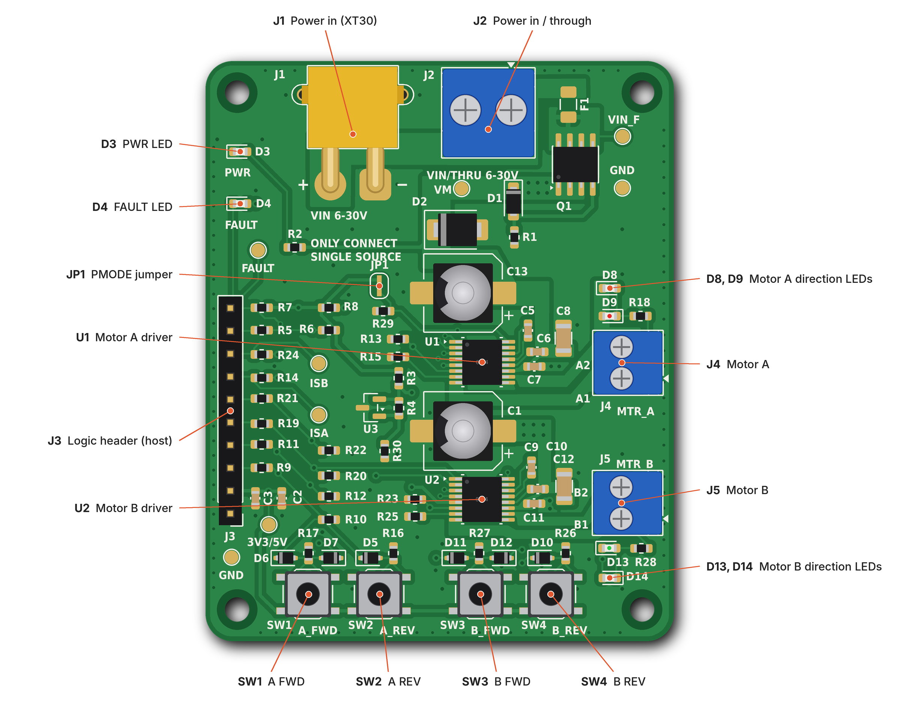

# Board overview

## Inputs

| Ref | Name | What it does |
| --- | --- | --- |
| J1 | Power in (XT30) | Battery or supply with an XT30 plug, 6–30 V. See [Powering the board](power.md) |
| J2 | Power in / through | Screw terminal in parallel with J1: A wired supply in, or power out to the next board |
| J3 | Logic header | Connects to the host: Power, direction and speed inputs, current sense, sleep and fault. See [J3 pinout](j3-pinout.md) |

## Outputs

| Ref | Name | What it does |
| --- | --- | --- |
| J4 | Motor A | Motor A terminals (OUT1 = A1, OUT2 = A2) |
| J5 | Motor B | Motor B terminals (OUT1 = B1, OUT2 = B2) |

## Controls

| Ref | Name | What it does |
| --- | --- | --- |
| SW1 / SW2 | A FWD / A REV | Run motor A forward or reverse at full speed while held |
| SW3 / SW4 | B FWD / B REV | Run motor B forward or reverse at full speed while held |
| JP1 | PMODE jumper | Open: PH/EN mode (default). Bridged: PWM mode. See [Configuration](configuration.md) |

See [Test buttons and LEDs](buttons-leds.md) for how the buttons behave with a host connected.

## Indicators

| Ref | Colour | Meaning |
| --- | --- | --- |
| D3 | Green | PWR: Motor supply present |
| D4 | Red | FAULT: A driver has shut down (short, overheating or low motor supply) |
| D8 / D13 | Green | Motor A / B running forward (OUT1 positive) |
| D9 / D14 | Red | Motor A / B running reverse (OUT2 positive) |

## Main parts

| Ref | Part | Role |
| --- | --- | --- |
| U1, U2 | TI DRV8874 | H-bridge drivers for motors A and B |
| F1 | 12 A fast-acting fuse | Disconnects the board if an internal fault or an over-voltage supply makes it draw excessive current. Normal motor stalls do not open it. Not resettable |
| U4 | 3.3 V regulator | Powers the test buttons and the board logic from the motor supply while a button is pressed |
| Q1 | P-channel MOSFET | Reverse-polarity protection |
| D2 | SMBJ30A | Surge suppressor on the motor supply |
| C13, C1 | 100 µF 50 V (×2) | Bulk capacitors, one beside each driver (U1, U2) |
| H1–H4 | M2.5 holes | Mounting |
