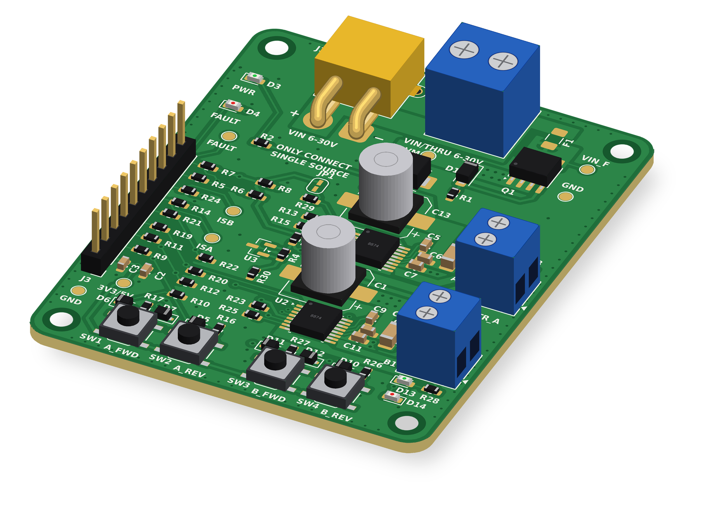

# User Guide

Board A drives two brushed DC motors in both directions from any 3.3 V or 5 V
microcontroller, such as a Raspberry Pi, ESP32, Raspberry Pi Pico or Arduino. Each motor
has its own TI DRV8874 H-bridge, with speed set by PWM, direction set by one pin, and a
current-sense output that can be read with an ADC.

- Two independent motor channels, motor supply 6–30 V (12 V and 24 V systems)
- Direction + speed control (PH/EN, phase/enable mode), with a jumper for two-input
  PWM (pulse-width modulation) mode
- Analog current feedback per motor (0.675 V/A) for stall detection
- Built-in 3 A current limit per motor, overcurrent and over-temperature protection
- Reverse-polarity protection, surge suppressor (TVS) and a 4 A fuse on the motor supply
- Push buttons to test each motor without writing code (PH/EN mode, the default)
- Direction LEDs per motor, plus power and fault LEDs
- Power through-terminal for daisy-chaining several boards from one supply
- Safe start-up: motors are held in brake while the host boots

## Where to start

1. Find your way around the board: [Board overview](board-overview.md).
2. Read [Important safety information](safety.md).
3. Wire the board using [Quick start](quick-start.md).
4. Check each motor with the [test buttons](buttons-leds.md) (PH/EN mode).
5. Install the library from the [API](../api/index.md) section and run the first example.

If something does not work, see [Troubleshooting](troubleshooting.md).
